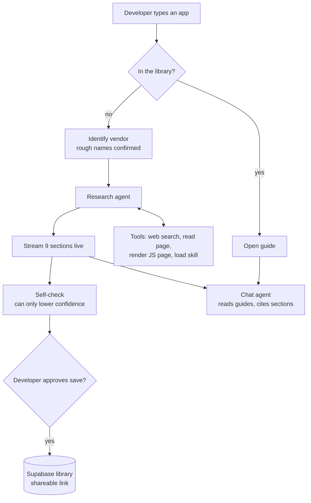

# OAuth Readiness Guides

**How long until your users can connect?** Setup and approval guides for developers building AI agents on Composio who need their own OAuth app, plus a live agent that writes a new guide for any app you name.

- **Live app:** https://oauth-snowy.vercel.app
- **Repo:** https://github.com/shreyc74-hub/Oauth-Agent
- **Evidence:** [`VERIFICATION.md`](VERIFICATION.md) (what we tested, corrected and could not verify) and [`attempts/`](attempts/) (setup logs)

## What it does

- **Library of 8 guides.** Slack, Linear, Notion, Gmail and Confluence were tested by creating real OAuth apps. HubSpot, Salesforce and LinkedIn were checked against official docs.
- **Type any app name or link.** Library apps open instantly. Rough names ("monday") are confirmed first. For anything new, the agent researches official docs, the changelog, secondary sources and Composio's docs, and streams a guide while you watch.
- **Every guide has the same 9 sections:** At a glance (with the decisions you can't undo), Prerequisites, App types, Creation steps, Scopes, Approval and distribution (with what's capped before approval), Data use and compliance, Common blockers, Sources.
- **Every claim links to its source:** official docs, a secondary source, or our setup log.
- **Chat on every guide**, and alongside a guide while it's being written. It answers from the guide, compares apps, and offers to research apps that aren't in the library.
- **Downloads:** PDF and Markdown. Saved guides get their own shareable link.

## Setup

The quickest way to try it is the live app. To run it yourself you need Node.js 20.9 or later and an Anthropic API key.

```bash
git clone https://github.com/shreyc74-hub/Oauth-Agent && cd Oauth-Agent
npm install
cp .env.example .env.local   # Windows: copy .env.example .env.local
# open .env.local and set ANTHROPIC_API_KEY
npm run dev                  # open http://localhost:3000
```

Without Supabase, guides you save are kept in memory until you restart. No API key? Set `AGENT_MOCK=1` in `.env.local` to run the whole flow offline with a replayed guide.

**Deploy:** Vercel plus Supabase. Run `supabase/schema.sql` then `supabase/seed.sql` in the Supabase SQL editor, then set `ANTHROPIC_API_KEY`, `SUPABASE_URL` and `SUPABASE_SERVICE_ROLE_KEY` in Vercel. `/status` shows what the server sees. Step-by-step instructions are in [`DEPLOY.md`](DEPLOY.md).

**Tests:** `npm test` (86 unit and edge-case tests against a fake Claude API, no network needed) and `npm run e2e` (browser click-through).

## How the agent works



- **Agent loop.** Claude decides which tool to call next, reads the result and decides again, for up to 12 rounds (`lib/agent/claude.ts`). The code sets the goal, the tools, the budget (10 searches, 8 page reads, 300 seconds) and the rules.
- **Two agents, one loop.** The research agent writes guides. The chat agent answers questions from guides (or from a draft while it's being written), compares apps, and offers research for apps not in the library.
- **Tools.** Web search and page reading (Anthropic server tools); rendering JavaScript-only pages; loading a skill; searching and reading the library; identifying a vendor; proposing research; proposing a correction.
- **Skills.** Eight instruction files in [`skills/`](skills/): research order, approval programs, scope risk, credential handoff, apps without OAuth, JavaScript pages, vendor identification, answering questions. The agent sees one-line descriptions and loads the full text only when it needs it, so know-how can be edited without touching code.
- **Guardrails.** Writes always wait for the developer (saving a guide, replacing one, saving a correction). The server forces agent output to "generated", refuses to overwrite library guides, blocks internal URLs, and rate-limits each network.
- **Fixed code where it should be.** Library lookup, confirming rough names and save rules are plain code: fast, cheap and predictable. The model is used where judgment is needed.
- **How the library was built.** Claude drove a real browser through five developer consoles to create the apps, with a person signing in and approving each create and terms screen. Client secrets were never shown to the agent.

## Key decisions

1. **The problem is approval, not creation.** Creating an OAuth app takes minutes. What blocks a launch is review (Google's annual security assessment, Slack's Marketplace review taking weeks) and the caps that apply until then (Slack's 1 request a minute, HubSpot's 25 installs, Google's 100 users over the app's lifetime). Guides lead with that.
2. **Test before writing.** An agent created real apps in five consoles, with a person approving sign-ins and terms. Each attempt corrected something: Linear apps are private by default, Notion defaults to an API token, and Google's user cap counts for the app's lifetime.
3. **Two ratings, two times.** Ease of creation and ease of approval are rated separately, and hands-on time is kept separate from waiting time. Slack is easy to create and hard to approve.
4. **Every step has an owner:** Agent, You, or Waiting on the provider.
5. **A real agent, fixed code where it should be.** The model chooses its own tools (web search, page reading, rendering JavaScript pages, loading skills, reading guides). Library lookup, name confirmation and save rules are plain code, so they're fast and predictable. Know-how lives in 8 skill files the agent loads when needed.
6. **Evidence over confidence.** Agent-written guides are always marked "generated" and can never claim "tested". A self-check before saving can only lower a claim's confidence, never raise it.
7. **Writes need permission.** Saving a guide or a correction always waits for a click. Generated guides can never replace a library guide.

## Limitations

- No app was submitted for provider review, so review times come from official docs and vendor reports.
- A generated guide depends on one research pass (up to 10 searches and 8 page reads) and isn't reviewed by a person until someone checks it.
- The self-check doesn't re-open source pages, so a claim citing a real page that says something else can get through. The next step is a live verifier that opens each cited page.
- Research runs inside one request (up to 300 seconds), so a run can't resume after a refresh. A finished guide is kept in the browser tab until it's saved.
- Composio's managed-app list didn't load in the docs we read, so "Is there a Composio-managed app?" is marked unknown unless a Composio page confirms it.
- Designed but parked: having the agent create the OAuth app itself in a cloud browser (one approval for the whole plan, pausing only for sign-in, terms or anything irreversible), credential handoff straight to a vault so nobody sees the client secret, an MCP connector so other agents and IDEs can use the library, and monthly freshness checks of every guide's sources.
